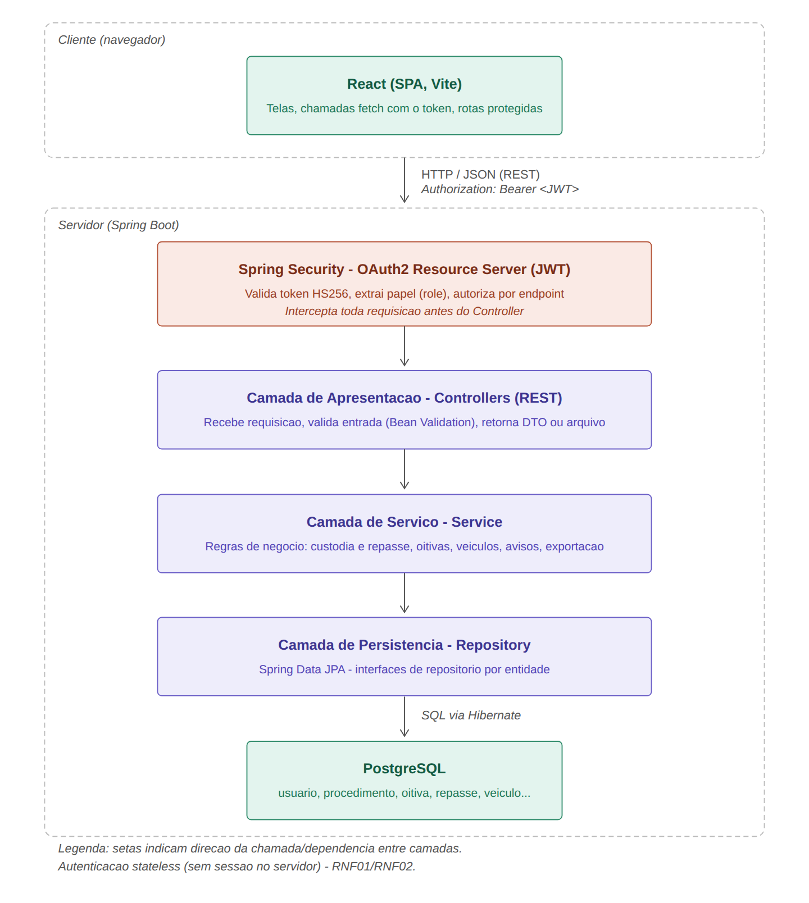
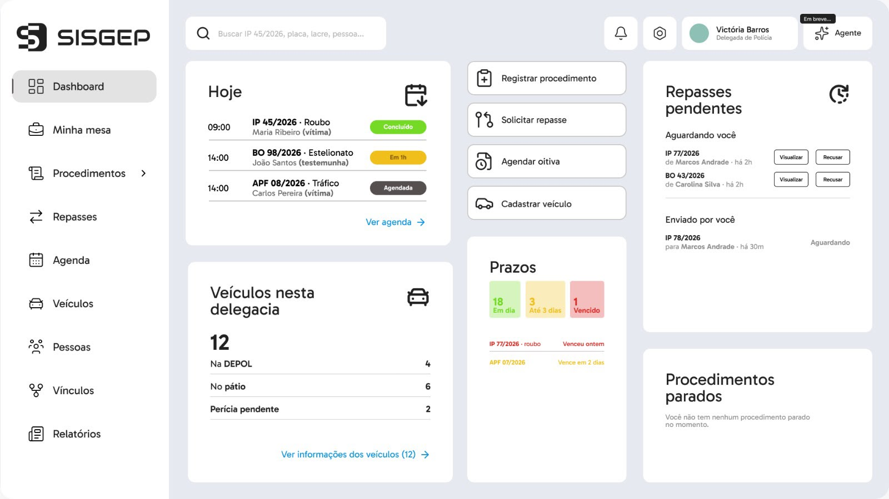
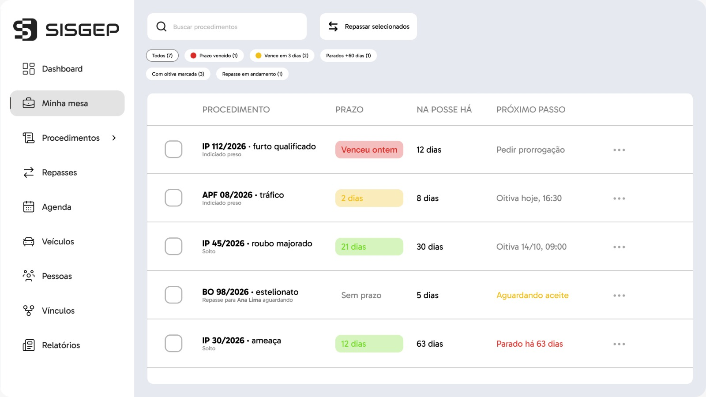

<p align="center">
  
</p>

<h1 align="center">SISGEP: Sistema Interno de Gestão Policial</h1>

<p align="center">
  API REST para o controle interno de uma delegacia: posse e repasse de procedimentos, oitivas,
  veículos apreendidos e pessoas envolvidas, com rastreabilidade de tudo o que acontece.
</p>

<p align="center">
  Projeto do <strong>Instituto Federal de Sergipe (IFS)</strong> submetido ao <strong>Inovathon</strong>, equipe <strong>Delegacia 4.0</strong>.<br>
  Front-end (React): <a href="https://github.com/jaopzj/sisgep-frontend">jaopzj/sisgep-frontend</a>
</p>

---

## O problema

Na rotina cartorária de uma delegacia, boa parte do controle interno ainda é feita em **livros, planilhas e papel**:
quem está com cada procedimento, quando a oitiva foi marcada, onde está o veículo apreendido, o que foi remetido.
Isso gera perda de rastreabilidade, retrabalho e dificuldade na conferência da carga da unidade.

O SISGEP reúne esse controle num só sistema, com histórico de cada mudança e acesso por perfil.
O controle de **prazos processuais** continua no sistema institucional da Polícia Civil: o SISGEP é o controle
interno da delegacia.

## Funcionalidades

| Módulo | O que faz |
|---|---|
| **Usuários e acesso** | Cadastro com aprovação pelo Admin, perfis (Admin, Delegado, Policial, Estagiário), login com JWT, gestão e redefinição de senha |
| **Procedimentos e custódia** | Cadastro (BO, IP, TCO, APF, AIAI, AAFAI, ROP), posse com histórico, **repasse com aceite** (pendente, aceito, recusado), arquivamento com histórico |
| **Oitivas** | Agenda com alerta de conflito de horário, remarcação, desmarcação com motivo, conclusão, sinalização de oitivas sem baixa e avisos automáticos |
| **Pessoas** | Cadastro de vítimas, testemunhas e investigados ligado às partes das oitivas, com as participações de cada pessoa (base do grafo de vínculos) |
| **Veículos apreendidos** | Cadastro com **lacre gerado pelo sistema**, situação (na DEPOL, pátio, devolvido, descartado) e perícia com histórico, alerta de duplicidade de placa/chassi/motor |
| **Painel e Minha mesa** | Visão do dia (oitivas, repasses pendentes, veículos na DEPOL) e a mesa do servidor com o **próximo passo** de cada procedimento |
| **Notificações** | Repasse recebido, oitiva próxima, atribuída ou sem baixa, cadastro pendente |
| **Exportação** | Relatórios de procedimentos e veículos em **XLSX e PDF** |

### Destaques

- **Etiqueta do veículo com QR code** (PDF 100 x 50 mm): o QR abre a ficha do veículo no sistema e não carrega dados.
- **Relatório de carga** em PDF, com coluna "Conferido" e campo de assinatura para a conferência física da unidade.
- **Minha mesa**: cada procedimento mostra há quanto tempo está na posse e o que fazer em seguida
  ("Aguardando aceite", "Oitiva hoje, 16:30", "Parado há 63 dias").
- **LGPD e sigilo desde o desenho**: CPF sempre mascarado na API, telefone e endereço só na ficha da pessoa,
  históricos imutáveis, registro de quem cadastrou e alterou, e implantação **local** em cada delegacia.

## Arquitetura

API REST em camadas (Controller → Service → Repository) consumida por uma SPA em React. A autenticação é
stateless (JWT validado pelo Spring Security) e a autorização é feita por perfil em cada rota.

<p align="center"></p>

**Implantação:** uma instância por delegacia, na rede interna, com Docker Compose (front, API e banco). Os dados
ficam na unidade (sigilo da investigação e LGPD) e o sistema funciona sem internet. A evolução para uma
implantação centralizada (multi-tenant, com o login da intranet da Polícia Civil) está prevista na documentação.

## Tecnologias

- **Back-end:** Java 21, Spring Boot 4, Spring Security (OAuth2 Resource Server, JWT), Spring Data JPA (Hibernate), Bean Validation, Lombok
- **Banco de dados:** PostgreSQL
- **Arquivos:** Apache PDFBox + ZXing (etiqueta com QR), Apache POI (XLSX), OpenPDF (relatórios em PDF)
- **Front-end:** React + Vite ([repositório](https://github.com/jaopzj/sisgep-frontend))

## Como executar

**Pré-requisitos:** Java 21 e PostgreSQL.

1. Crie um banco vazio no PostgreSQL.
2. Copie `.env.example` para `.env` e preencha (banco, `JWT_SECRET` com pelo menos 32 caracteres, login e senha do
   Admin inicial). Para o front em React, use `CORS_ORIGENS_PERMITIDAS=http://localhost:5173`.
3. Suba a API:
   ```bash
   ./mvnw spring-boot:run        # Windows: mvnw.cmd spring-boot:run
   ```
   As tabelas, os perfis e o Admin inicial são criados na primeira execução. A API fica em `http://localhost:8080`.

### Dados de demonstração

O script [`docs/demo/dados-demonstracao.sql`](docs/demo/dados-demonstracao.sql) popula um banco **de
demonstração** com dados fictícios (usuários, procedimentos, oitivas, pessoas, veículos e repasses), com datas
relativas ao dia em que é executado. Depois de subir a API uma vez, rode o script no pgAdmin/DBeaver e entre com
`vbarros` / `Demo@2026`. O script apaga os dados anteriores do banco (menos perfis e Admin): use um banco só para isso.

## Documentação

- [Documentação do projeto](docs/SISGEP_Documentacao.docx): visão, requisitos, casos de uso, modelagem, arquitetura, implantação e protótipo de telas
- [Contrato das rotas](docs/endpoints.md): JSON de entrada e saída e erros de cada endpoint
- [Diagramas](docs/diagramas/): DER, diagrama de classes, casos de uso, arquitetura e implantação
- [Protótipo das telas](docs/img/telas/)

<p align="center">
  
  
</p>

## Próximos passos

O objetivo é que o SISGEP centralize a custódia e a organização interna da delegacia:

- **Controle de ofícios expedidos**, substituindo o livro cartorário (já especificado: RF30 a RF35)
- **Custódia de objetos apreendidos**
- **Gestão patrimonial** da delegacia (bens, responsáveis, movimentações e baixa)
- **Fotos da apreensão** na ficha do veículo
- **Importação do acervo**, para que a carga completa da delegacia esteja no banco e o relatório de carga saia com um clique
- Assistente com IA para resumo de procedimentos, com as diretrizes de sigilo da documentação (em desenvolvimento)
- Grafo de vínculos entre pessoas, procedimentos e veículos (em desenvolvimento)
- Distinção do Delegado titular em delegacias com mais de um delegado
- Implantação centralizada multi-tenant, com o login da intranet institucional

## Equipe

- **Laíssa Victória Barros** (líder)
- Elton Ramon Alves Santos
- Erick Marques Santos Bomfim
- Hebert Ruan do Nascimento Feitosa
- João Pedro da Silva Carvalho

> Todos os dados usados em testes, demonstrações e telas são fictícios.
